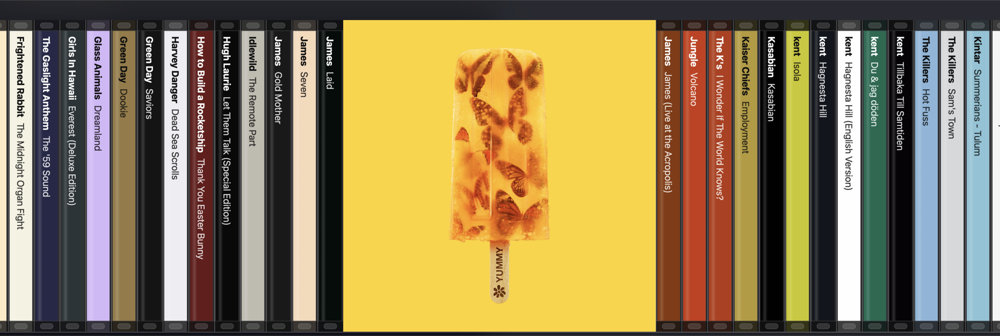

# Shelf

Shelf is a macOS menu bar app that shows your saved Spotify albums as a shelf of CD jewel cases.
Click the tray icon and a shelf opens under the menu bar, across the width of the screen.
Scroll left and right to flick through your albums; the album in the middle turns to show its cover.
Click the open album to play it in Spotify.

The idea comes from the Spine Music wall display.



## Requirements

- macOS 11 or later. The code builds on Windows and Linux, but only macOS is tested.
- Rust 1.90 or later, and the Xcode Command Line Tools.
- Node.js 22.12 or later, and pnpm.
- A Spotify account. Playing albums from Shelf needs Spotify Premium; browsing the shelf does not.

You can try Shelf without a Spotify account: click **Try the demo** on the first screen.
The demo shows 240 made-up albums with generated covers.

## Set up a Spotify app

Shelf uses your own Spotify app, because Spotify only lets an app in Development Mode serve users that its owner lists.
There is no client secret: Shelf uses the Authorization Code flow with PKCE.

1. Open the [Spotify Developer Dashboard](https://developer.spotify.com/dashboard) and log in.
2. Click **Create app**.
3. Enter any app name and description.
4. Add this Redirect URI: `http://127.0.0.1:43821/callback`.
5. Select **Web API** among the APIs the app uses.
6. Accept the terms and click **Save**.
7. Open the app's **Settings** and copy the **Client ID**.
8. To let someone else use your app, add their name and Spotify email under **User Management**.

Then connect Shelf:

1. Start Shelf and click its tray icon.
2. Paste the Client ID and click **Connect**.
3. Approve access in the browser that opens.

Shelf then syncs your library. The first sync downloads every cover, so it takes longer than later syncs.

## Build and run

Install the tools, if you do not have them:

1. Install the Xcode Command Line Tools: `xcode-select --install`.
2. Install Rust with [rustup](https://rustup.rs): `curl --proto '=https' --tlsv1.2 -sSf https://sh.rustup.rs | sh`.
3. Install Node.js 22.12 or later from [nodejs.org](https://nodejs.org), or with `brew install node`.
4. Turn on pnpm, which ships with Node.js: `corepack enable pnpm`.

Then install the project's packages and start Shelf:

```sh
pnpm install
pnpm tauri dev
```

The first `pnpm tauri dev` compiles every Rust crate, so it takes a few minutes.
Shelf appears as an icon in the menu bar, not in the Dock.

| Command | What it does |
|---|---|
| `pnpm tauri dev` | Runs Shelf with live reload. |
| `pnpm tauri build` | Builds `src-tauri/target/release/bundle/macos/Shelf.app`. |
| `pnpm test` | Runs the TypeScript tests. |
| `pnpm typecheck` | Checks the TypeScript types. |
| `cargo test` (in `src-tauri`) | Runs the Rust tests. |
| `VITE_SHELF_STRESS_TEST_ALBUM_COUNT=1200 pnpm tauri dev` | Repeats the library to 1,200 albums, sweeps the shelf, and shows frame times in the toolbar. |

## Use

| Action | Result |
|---|---|
| Click the tray icon | Opens or closes the shelf. |
| Scroll or swipe sideways | Moves along the shelf. It settles with one album in the middle. |
| Click a spine | Brings that album to the middle. |
| Click the open album | Plays it in Spotify. |
| Esc, or click elsewhere | Closes the shelf. |
| Refresh, Settings, Quit | The buttons at the top of the shelf. |
| Start Shelf at login | A checkbox in Settings, on by default. Builds from `pnpm tauri dev` do not register at login. |

When the shelf opens, the album Spotify is playing is in the middle, and a green bar on the ledge marks it.

## How it works

1. **Sign-in.** Shelf opens Spotify's consent page in your browser. A small server on `127.0.0.1:43821` receives the redirect. Shelf exchanges the code for tokens, stores the refresh token in the macOS Keychain, and keeps the access token in memory only.
2. **Library sync.** Shelf reads your saved albums from `GET /me/albums`, 10 at a time, because Development Mode allows no more per page. It syncs on launch when the stored library is older than 6 hours, and when you click **Refresh**. When Spotify answers 429, Shelf waits for the time in `Retry-After`.
3. **Cover cache.** Shelf downloads each cover once. It asks Spotify's image server for the 2000 px version, and falls back to the 640 px version that the Web API lists. The Rust side then decodes each new cover once, writes a 256 px thumbnail, and samples the dominant colour for the spine. While a sync runs, a spinner covers the shelf.
4. **The shelf.** PixiJS draws the shelf with WebGL. Only the albums on screen have display objects, so a library of 1,000 albums scrolls at 60 frames per second. An opening album shows its thumbnail at once. When an album stays in the middle for 100 ms, its full cover loads and fades in over the thumbnail.
5. **Playing.** A click sends `PUT /me/player/play` with the album. Shelf picks the active Spotify device, or else the Spotify app on this Mac. If neither is available, Shelf opens the album in Spotify, waits for this Mac to appear as a device, and then plays.
6. **Now playing.** While the shelf is open, Shelf reads `GET /me/player` every 5 seconds. It stops when the shelf closes.

Shelf keeps its data in `~/Library/Application Support/com.example.shelf/`:

| File | Contents |
|---|---|
| `app_settings.json` | Your Client ID, sort order, whether demo mode is on, and whether Shelf starts at login. |
| `albums.json` | The synced library. |
| `covers/` | The cached covers and their thumbnails. |

The Keychain item has the service `com.example.shelf` and the account `spotify_refresh_token`.
To sign out, click **Disconnect** in Settings; Shelf then deletes the Keychain item.

## Project layout

```
src/                                   TypeScript frontend
  main.ts                              Start-up, view switching, sync and playback
  app_settings_store.ts                app_settings.json
  start_at_login.ts                    Registers or removes the login item
  spotify/
    spotify_pkce_auth.ts               PKCE sign-in and token requests
    spotify_access_token_session.ts    Access token in memory, background refresh
    spotify_web_api_client.ts          Web API requests, 401 refresh, 429 and 5xx retry
    spotify_album_playback.ts          Device choice and PUT /me/player/play
    spotify_now_playing_poller.ts      GET /me/player while the shelf is open
  library/
    saved_album.ts                     The album record stored in albums.json
    saved_albums_sync.ts               Fetches the library and caches covers
    saved_albums_library_store.ts      albums.json and its 6-hour staleness
    album_cover_cache.ts               Cover downloads and loading
    saved_album_sort_order.ts          Recently added, artist A–Z, album A–Z, release year
  shelf/
    shelf_layout.ts                    Spine and cover positions, scrolling, hit testing
    shelf_renderer.ts                  PixiJS drawing of the jewel cases
    shelf_spine_label.ts               Spine label fitting and contrast
    shelf_cover_texture_cache.ts       Full cover textures, most recent first
    shelf_cover_thumbnail_textures.ts  Thumbnail textures for every album
  views/
    shelf_view.ts                      Toolbar and shelf
    spotify_connection_view.ts         First-run screen and Settings
  demo/                                Generated demo library and covers
src-tauri/src/                         Rust
  tray_icon_and_window.rs              Tray icon, window placement and hiding, Quit
  spotify_app_launcher.rs              Starts Spotify hidden when no device is available
  oauth_loopback_callback_server.rs    Receives the sign-in redirect
  spotify_refresh_token_keychain.rs    Keychain storage of the refresh token
  album_cover_thumbnail_and_colour.rs  Cover thumbnails and spine colours
```

## Licence

MIT. See [LICENSE](LICENSE).
